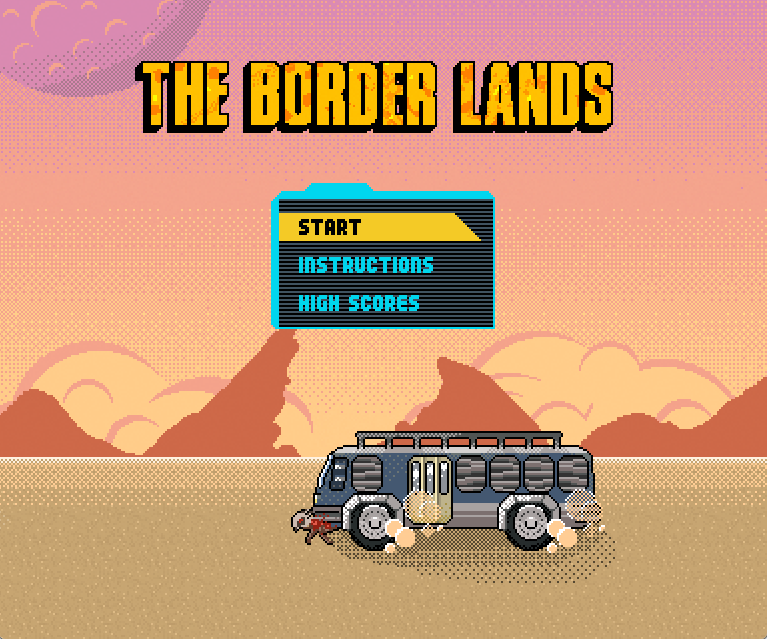
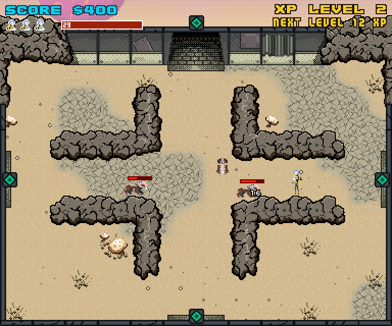
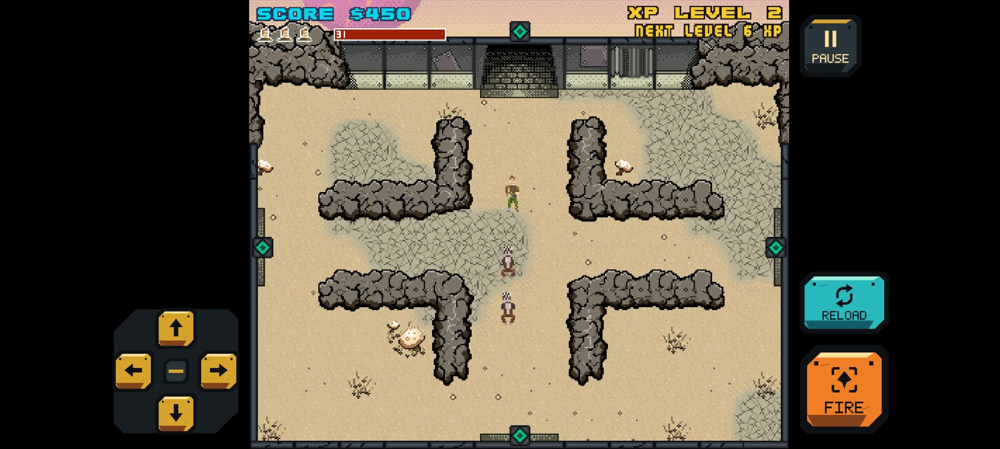
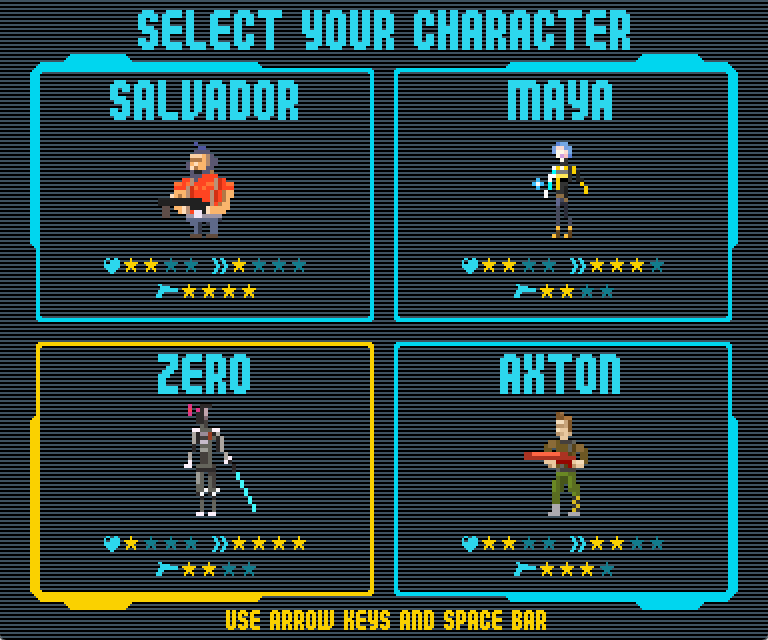
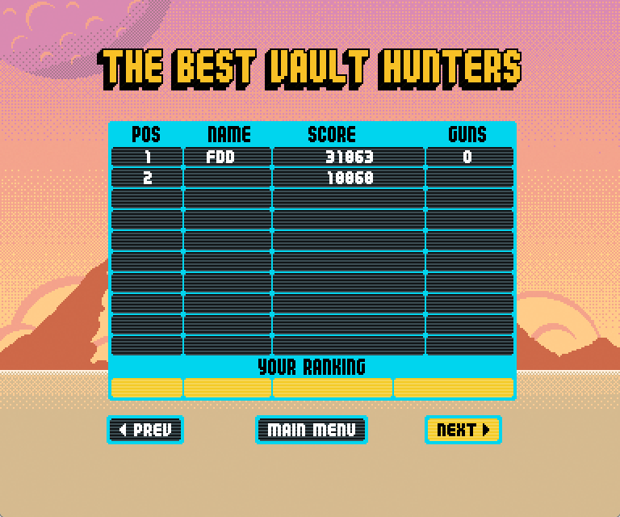

# The Border Lands - Native Edition

A native version of **The Border Lands**, the free Flash promotional game released in 2012 for *Borderlands 2*. Also knows as Borderlands 2 Demake.

Rebuilt in **C++20/SDL2** to run on modern Windows, Linux, and Android devices, without Flash, Ruffle, or an internet connection.



## Download

Get the latest version from [Releases](../../releases).

| Platform | File |
|---|---|
| Windows 10/11 (x64) | `Borderlands2Demake-Windows-x64.exe` |
| Linux (x86-64) | `Borderlands2Demake-Linux-x86_64.AppImage` |
| Android 7.0+ (ARM64) | `Borderlands2Demake-Android-arm64.apk` |

**Windows:** Download and run the `.exe`.

**Linux:** Download the AppImage and run it. If doesn't run, make it executable following these commands:

```bash
chmod +x Borderlands2Demake-Linux-x86_64.AppImage
./Borderlands2Demake-Linux-x86_64.AppImage
```

**Android:** Download the `.apk` and install it on your device. You may need to allow installation from your browser or file manager.

## Controls

| Action | Key |
|---|---|
| Move | Arrow keys / WASD |
| Fire | Space / Z |
| Reload | R |
| Pause | P / Esc |
| Mute | M |
| Fullscreen | F11 / Alt+Enter |

Menus support keyboard and mouse.

Android supports on-screen touch controls for movement, firing, reloading, weapon selection, and pause.

 

## Features

- Native Windows, Linux, and Android support.
- Four playable Vault Hunters: Salvador, Maya, Zer0, and Axton
- Original weapons, enemies, maps, graphics, and audio.
- Gameplay reconstructed to closely match the Flash original.
- Offline leaderboard with local high scores.
- Portable executables with embedded game assets.

 

## Credits

All original Borderlands characters, artwork, audio, and related intellectual property belong to their respective owners.

This is a free, unofficial, non-commercial preservation project, not affiliated with or endorsed by Gearbox Software or 2K.

## Bugs

Found an issue? Open a [GitHub Issue](../../issues).
Feedback is especially welcome for platform compatibility, input, audio, and gameplay behavior.

Made for preservation. Shared with the Borderlands community.

Keep the Vault Hunters alive.
